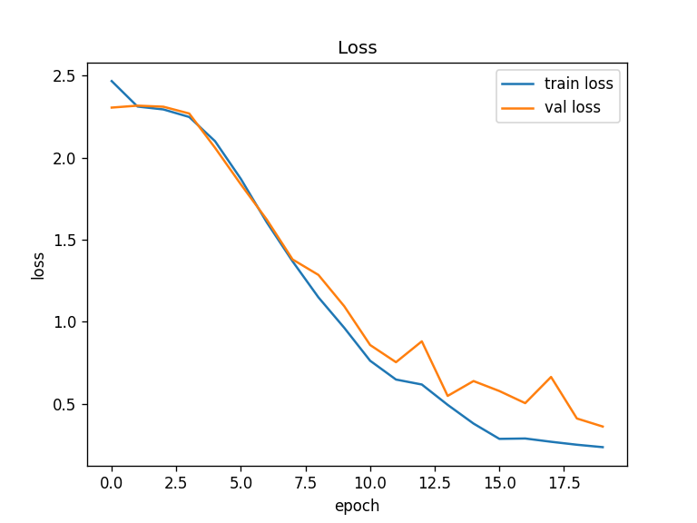
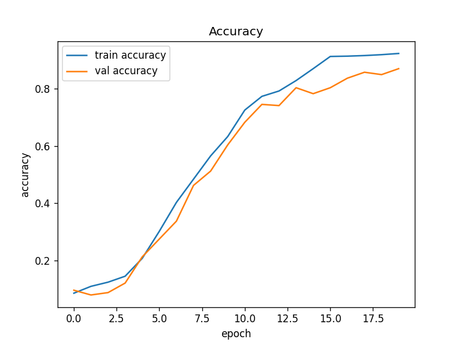

# Lip reading with a 3D-CNN (Keras / TensorFlow)

A 3D convolutional network that classifies short lip-movement video clips into 10 words. A 3D convolution slides across the frames as well as across the picture, so it can see motion, which a single frame does not contain.

## Setup

- Data: MIRACL-VC1, 15 speakers x 10 words x 10 repetitions = 1,500 clips. Only the color frames are used (each instance folder also holds depth images). The dataset is not in this repo.
- Preprocessing: clips have different numbers of frames (and arrays of different lengths cannot be stacked), so every clip is reduced to 10 evenly spaced frames, resized from 640x480 to 64x64, and scaled to 0 to 1. One clip is an array of shape `(10, 64, 64, 3)`. Clips and labels are shuffled together.
- Split: 1,200 clips for training and 300 for the final test. Of the 1,200, Keras holds out 20% (240 clips) for validation, so 960 are used for training.
- Model: 3 blocks of a `Conv3D` (3x3x3 kernel, 16, 32, 64 filters, ReLU) followed by max pooling over height and width only (`pool_size=(1, 3, 3)`), then Dense 256, Dense 10 and a 10-way softmax. 1,711,864 parameters.
- Training: nadam, categorical cross-entropy, batch size 32, 20 epochs, seed 42.

## Results

One seeded run (seed 42), final epoch values. Test accuracy is on the 300 clips the model never trained on. Guessing at random gets about 0.10.

| Train acc | Val acc | Test acc | Final train loss | Final val loss | Test loss |
|---|---|---|---|---|---|
| 0.924 | 0.871 | 0.890 | 0.238 | 0.363 | 0.338 |




On the first 10 test clips the model predicts 9 correctly (`results/predictions.txt`); it reads "previous" as "stop" once. Ten clips is a tiny sample, so this is an illustration.

What the run shows:

- Both losses start near 2.30, which is `-ln(0.1)`, the loss of a model that gives every word probability 0.1. They start falling after about epoch 4.
- Validation loss was still falling at epoch 20 (its lowest value is at the last epoch), so 20 epochs was not enough to see where overfitting would begin. I did not train longer.

What it does not show:

- **The split is by clip, so the same 15 speakers appear in train and test.** The model may partly learn speakers, not only lip movement. How it does on a speaker it has never seen was not measured; holding out whole speakers is the test to run next.
- This is a single seeded run. In three earlier runs of the same model without a seed, the test accuracy was 0.837, 0.872 and 0.892, so 0.890 here is the top of that range, and the honest summary is "about 0.84 to 0.89".
- The frames are the whole face resized to 64x64, so the lips are only a few pixels wide. Cropping to the mouth would probably help; not tried.
- The three `Dense` layers have no activation between them, so together they act like one linear layer. A ReLU after the 256-unit layer is an easy change to try; not tried.

## Run it

```
pip install -r requirements.txt
python train.py --data /path/to/dataset
```

`/path/to/dataset` is the folder that holds one folder per speaker (`F01`, `F02`, ...), each with `words/01` to `words/10`, then repeats `01` to `10`, then `color_NNN.jpg` frames. The word ids 01 to 10 are: begin, choose, connection, navigation, next, previous, start, stop, hello, web. I used a Kaggle re-host of the dataset (`apoorvwatsky/miraclvc1`), whose license is listed as unknown; check the original MIRACL-VC1 terms before reusing it.

Loading the 1,500 clips takes about 25 seconds, and training takes about 20 seconds per epoch on a laptop CPU. The run saves the trained model to `results/model.keras` (20.6 MB: architecture, weights and optimizer state), the plots, `summary.json` and `predictions.txt`. To predict without retraining:

```python
from keras.models import load_model
model = load_model("results/model.keras")
probabilities = model.predict(clips)  # clips: shape (n, 10, 64, 64, 3), pixels scaled to 0 to 1
```

Tested with TensorFlow 2.20 and Keras 3.10.
